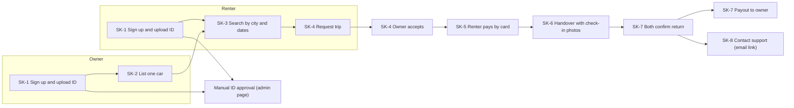

# Peer-to-peer car sharing: user story map and walking skeleton

A 2D story map for a digital peer-to-peer car sharing app, with the walking skeleton MVP extracted as the top release lane.

- **Horizontal axis:** the backbone, meaning what each person is trying to do, in time order.
- **Vertical axis:** priority. Each lane below the backbone is a release slice.
- **Personas:** Owner (lists a car) and Renter (books a car).

## Contents

1. [Story map](#story-map)
2. [Walking skeleton flow](#walking-skeleton-flow)
3. [What is real and what is crude](#what-is-real-and-what-is-crude)
4. [How the skeleton was extracted](#how-the-skeleton-was-extracted)
5. [Skeleton backlog](#skeleton-backlog)
6. [Decisions to settle before building](#decisions-to-settle-before-building)
7. [Done criteria](#done-criteria)

---

## Story map

| | 1. Join and verify | 2. List a car | 3. Find a car | 4. Book a trip | 5. Pay and protect | 6. Hand over and drive | 7. Return and settle | 8. Build trust |
|---|---|---|---|---|---|---|---|---|
| **Persona** | Both | Owner | Renter | Both | Both | Both | Both | Both |
| **Tasks** | Create account, prove identity | Describe car, set price | Search by place and dates | Request trip, owner decides | Pay fare, get covered | Meet, check condition, unlock | End trip, pay owner | Rate, report, resolve |
| **Walking skeleton** | **SK-1** Sign up with email; upload ID and licence photos for manual review | **SK-2** Add one car: make, model, photos, daily price, pickup spot | **SK-3** Search by city and dates; open a listing | **SK-4** Renter requests dates; owner accepts or declines | **SK-5** Pay by card through one provider; blanket insurance policy | **SK-6** Meet in person; both log check-in photos | **SK-7** Both confirm return; payout to owner | **SK-8** Email link to contact support |
| **Release 1: usable MVP** | Phone OTP and social login Automated ID check | Availability calendar Mileage and fuel rules | Map view and filters Saved cars | In-app chat Instant book and cancellation policy | Security deposit hold Promo codes | Pickup reminders Photo-based damage comparison | Late-return fees Receipts and automated payouts | Two-way reviews In-app dispute form |
| **Release 2: growth** | Driving-record checks Fleet owner accounts | Smart price suggestions Multi-car dashboard | Personalised picks Car delivery to renter | Long-term rentals Split payments | Tiered insurance Loyalty credits | Keyless unlock Roadside assistance | Fines and tolls handling Automated damage claims | Trust score Referral programme |

---

## Walking skeleton flow

One owner and one renter complete one real trip, from sign-up to payout.

---

## What is real and what is crude

| Step | Real in the skeleton | Deliberately crude |
|---|---|---|
| Verify | ID and licence upload, stored securely | A team member approves each one from an admin page |
| List | Listing with photos, price and pickup point | One flat daily price, no calendar |
| Search | Query by city and dates against real listings | Simple list, no map or filters |
| Book | Request, accept or decline, status change | No chat; status updates by email or push |
| Pay | Real card charge through one provider | No deposit hold or promo codes |
| Insure | One platform-wide policy or partner cover | No tiers or per-trip choices |
| Handover | Check-in photos and a timestamp on both sides | Keys exchanged in person, no keyless unlock |
| Return | Both confirm, trip closes | No late fees or damage claims |
| Payout | Owner gets paid for the trip | Can be a manual or scheduled transfer |
| Support | A "contact us" email link | No ticketing or disputes |

---

## How the skeleton was extracted

Three rules were applied to the map:

1. Read the backbone left to right and pick the single thinnest story per activity that still lets one trip complete from listing to payout.
2. Keep a story only if removing it breaks the end-to-end flow. Nice-to-haves such as chat, filters and reviews do not pass this test.
3. Accept a manual or crude version of a step if it still exercises every architectural layer: client, API, database, payments, notifications and file storage.

Why this slice:

- It is deliberately shallow. It works end to end, so every integration (identity storage, payments, notifications, booking state machine) is proven early, while the richer features arrive later.
- It tests the biggest risks first: whether owners will list, whether renters will pay, and whether insurance and handover are workable.
- Every Release 1 story deepens a skeleton step rather than adding a new one. For example, phone OTP and automated ID checks replace manual review, and a deposit hold extends the card payment.

---

## Skeleton backlog

- [ ] **SK-1** Sign up with email; upload ID and licence photos for manual review
- [ ] **SK-2** Add one car: make, model, photos, daily price, pickup spot
- [ ] **SK-3** Search by city and dates; open a listing
- [ ] **SK-4** Renter requests dates; owner accepts or declines
- [ ] **SK-5** Pay by card through one provider; blanket insurance policy
- [ ] **SK-6** Meet in person; both log check-in photos
- [ ] **SK-7** Both confirm return; payout to owner
- [ ] **SK-8** Email link to contact support

Suggested first Release 1 items, chosen because they remove manual work or reduce risk:

- [ ] Automated ID check
- [ ] Security deposit hold
- [ ] Two-way reviews

---

## Decisions to settle before building

- **Insurance** is the item most likely to block launch. Confirm early whether a partner policy covers the pilot market.
- **App shape:** decide whether the skeleton needs two apps (owner and renter) or one app with role switching. One app is cheaper.
- **Payments provider:** choose it with payouts to owners in mind, since that is harder than taking a card payment.

---

## Done criteria

The skeleton is done when an owner and a renter who do not know each other can complete a real trip, with real money moving and no engineer intervening apart from the manual ID approval.
